# PMU OS — Hệ điều hành vận hành có AI Agent cho doanh nghiệp dịch vụ PMU

Phần mềm quản trị nhân sự và chăm sóc khách hàng cho doanh nghiệp dịch vụ PMU (phun mày, môi, mí), có **đội AI Agent** làm việc bên trong: tự quét dữ liệu, tra **Bộ não thứ 2**, soạn sẵn trả lời Zalo và đề xuất giao việc. Mọi đề xuất đều chờ con người duyệt trước khi thực hiện.

**Dùng thử ngay:** https://pmu-os-xi.vercel.app → bấm **Khám phá bản demo** (không cần tài khoản).

> Toàn bộ tên nhân sự, khách hàng, số điện thoại và số liệu trong phần mềm và trong ảnh dưới đây là **DỮ LIỆU MÔ PHỎNG**: tên Việt hư cấu, số điện thoại dạng `0123…` không có thật. Kênh Zalo **chưa kết nối**, nên không tin nhắn nào được gửi ra ngoài.

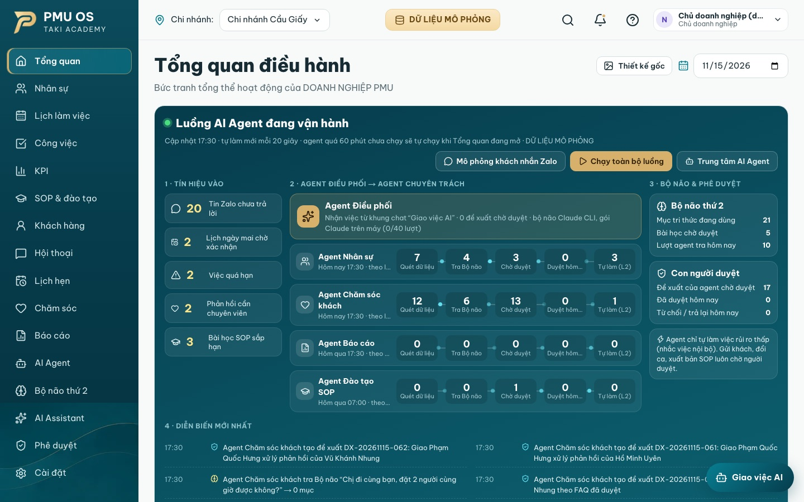

---

## Mục lục

- [Tính năng](#tính-năng)
- [Hướng dẫn sử dụng nhanh](#hướng-dẫn-sử-dụng-nhanh)
- [Chạy trên máy](#chạy-trên-máy)
- [Bộ não ngôn ngữ cho trợ lý](#bộ-não-ngôn-ngữ-cho-trợ-lý)
- [Đưa lên Vercel](#đưa-lên-vercel)
- [Kiểm thử nghiệm thu](#kiểm-thử-nghiệm-thu)
- [Kiến trúc và thư mục](#kiến-trúc-và-thư-mục)
- [Giới hạn hiện tại](#giới-hạn-hiện-tại)

---

## Tính năng

### 1. Luồng AI Agent chạy trực tiếp trên màn Tổng quan

Màn hình chính cho thấy toàn bộ tiến trình vận hành, làm mới mỗi 20 giây:

1. **Tín hiệu vào:** tin Zalo chưa trả lời, lịch ngày mai chờ xác nhận, việc quá hạn, phản hồi cần chuyên viên, bài học SOP sắp hạn.
2. **Agent Điều phối → 4 agent chuyên trách**, mỗi agent có 5 chặng: Quét dữ liệu → Tra Bộ não → Chờ duyệt → Duyệt hôm nay → Tự làm (L2).
3. **Bộ não thứ 2 và Con người duyệt:** số mục tri thức đang dùng, bài học chờ duyệt, đề xuất chờ duyệt.
4. **Diễn biến mới nhất:** agent vừa chạy, vừa tra Bộ não, vừa tạo đề xuất, quản lý vừa duyệt.

Có nút **Chạy toàn bộ luồng** và **Mô phỏng khách nhắn Zalo** để xem agent xử lý một tin đến: đọc tin, tra Bộ não, soạn sẵn câu trả lời và tạo đề xuất chờ duyệt.

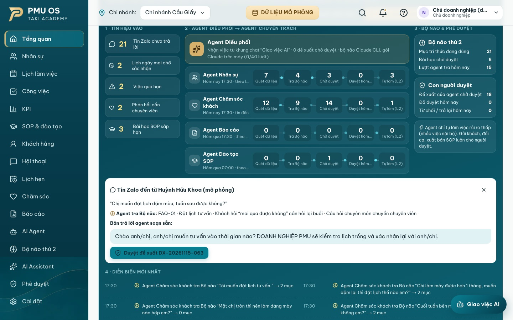

### 2. Khung chat “Giao việc AI” ở mọi màn hình

Nút **Giao việc AI** ở góc phải dưới. Giao việc bằng một câu tiếng Việt; trợ lý tự tra nhân sự, lịch hẹn, khách hàng, Bộ não rồi tạo **đề xuất chờ duyệt** (không tự tạo việc thật, không tự gửi khách).

Câu mẫu:

- `Giao Nguyễn Thị Lan gọi xác nhận các lịch hẹn ngày mai trước 10:00`
- `Hôm nay có việc nào quá hạn?`
- `Khách nóng nào chưa có lịch hẹn? Soạn tin mời khách đầu tiên đặt lịch tư vấn`
- `Chạy agent chăm sóc khách`
- `Tra bộ não: khách hỏi giá`

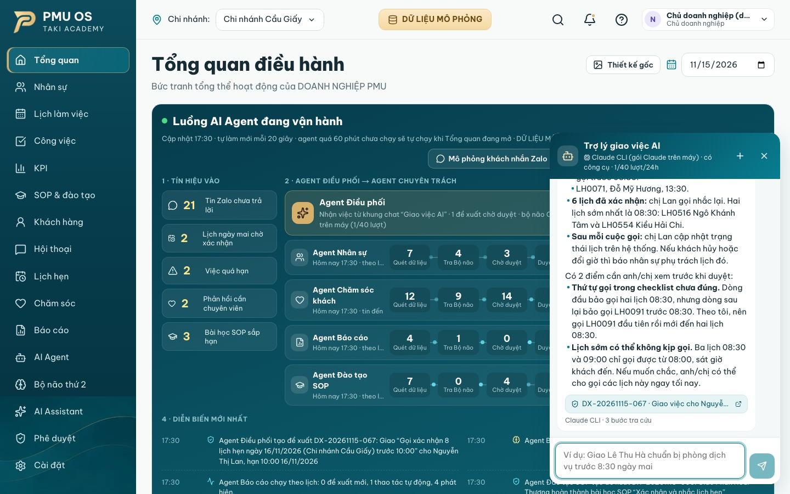

### 3. Trung tâm AI Agent

| Agent | Việc làm | Kết quả |
| --- | --- | --- |
| **Agent Điều phối** | Nhận việc từ khung chat, tra dữ liệu theo quyền người chat | Trả lời có nguồn, đề xuất giao việc / nhắn khách |
| **Agent Nhân sự** | Theo dõi việc quá hạn, ca thiếu người, ca trùng giờ | Tự nhắc việc nội bộ (L2), đề xuất bổ sung / điều chỉnh ca (tối đa 6 mỗi lượt) |
| **Agent Chăm sóc khách** | Lịch chưa xác nhận, tin Zalo chưa trả lời, phản hồi cần chuyên viên | Đề xuất giao việc gọi xác nhận, bản trả lời theo FAQ đã duyệt, insight ý định khách |
| **Agent Báo cáo** | Tổng hợp số liệu cuối ngày | Báo cáo nháp có nguồn, mốc dữ liệu, phần chưa chắc chắn |
| **Agent Đào tạo SOP** | Bài học SOP sắp hạn, SOP chờ duyệt | Đề xuất giao việc học, không tự xuất bản tài liệu |

Bật/tắt từng agent, **dừng khẩn cấp** toàn hệ, xem nhật ký từng lượt chạy (agent đã tra gì trong Bộ não, tạo đề xuất nào, tự làm gì). Agent không tạo đề xuất trùng khi chạy lại.

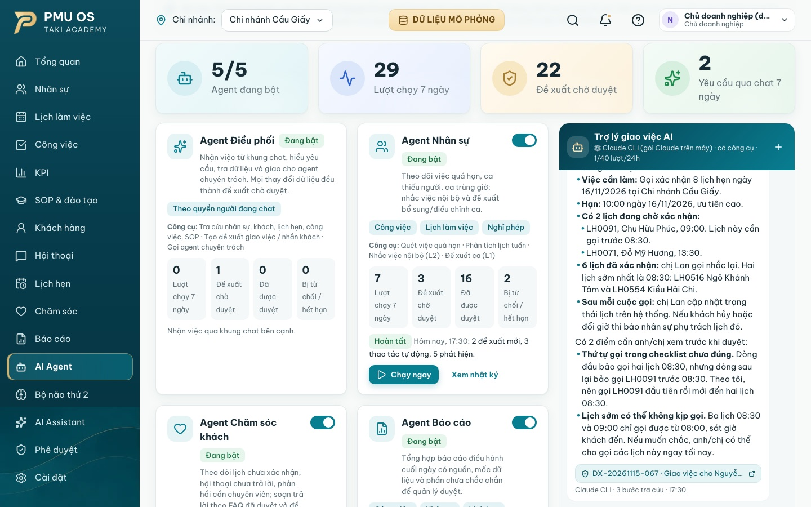

### 4. Bộ não thứ 2

Kho tri thức dùng chung của đội agent: **quy tắc, bài học, insight khách, ghi nhớ vận hành, quyết định**, cùng FAQ và SOP đã duyệt.

- Agent tra Bộ não trước khi làm và ghi rõ đã dùng mục nào.
- Bài học / insight do agent tự rút ra luôn ở trạng thái **chờ duyệt**; quản lý duyệt xong agent mới được dùng.
- Mục có nhãn “Giả thuyết” chưa được kiểm chứng bằng số liệu, agent không dùng như số liệu.
- Thẻ **Ý định khách 7 ngày** đếm trực tiếp từ tin nhắn Zalo.

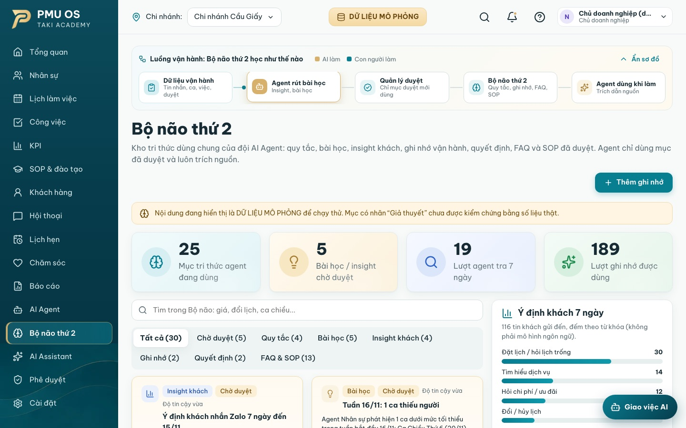

### 5. Hội thoại Zalo có agent trả lời sẵn

Bộ mô phỏng có **20 kịch bản hội thoại Zalo**: 11 câu trả lời agent soạn đã được quản lý duyệt, 7 bản soạn sẵn đang chờ duyệt, 2 câu hỏi chuyên môn / khiếu nại được chuyển chuyên viên (agent không tự trả lời). Tin do agent soạn có nhãn **AI Agent soạn sẵn · theo FAQ-…**.

Agent không báo giá khi chưa có bảng giá duyệt, không tư vấn chuyên môn thẩm mỹ, không hứa kết quả.

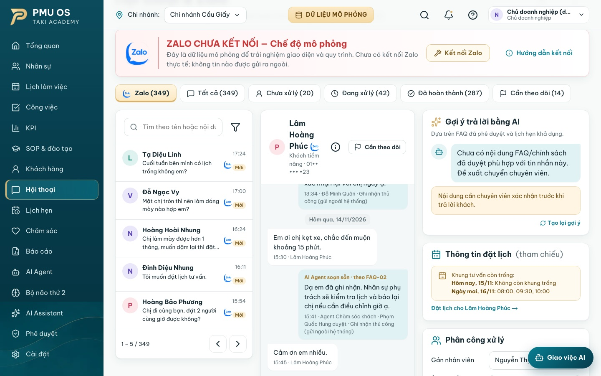

### 6. Con người duyệt, hệ thống thực thi

Mọi đề xuất (của agent hay nhân sự) có trước/sau, lý do, nguồn, hạn duyệt. Duyệt hai lần chỉ thực thi một lần; dữ liệu gốc đã đổi thì đề xuất bị trả lại, không thực thi trên dữ liệu cũ.

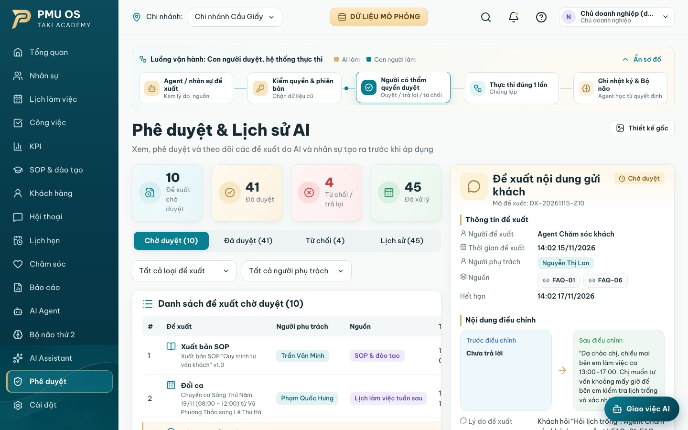

### 7. Sơ đồ hình khối chạy ở mỗi menu

Đầu mỗi menu có sơ đồ luồng vận hành chạy lần lượt từng bước: **ô vàng là việc AI làm, ô xanh là việc con người làm**. Có thể ẩn/hiện.

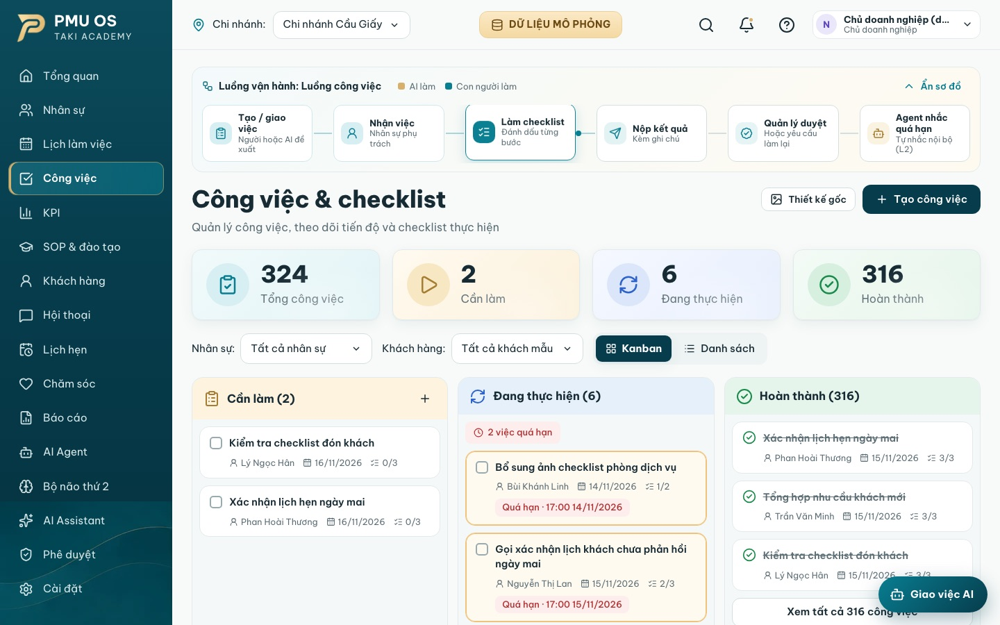

### 8. Đủ các phân hệ vận hành

Tổng quan · Nhân sự · Lịch làm việc · Công việc (checklist, nộp, duyệt) · KPI theo vai trò · SOP & đào tạo · Khách hàng (hành trình 8 giai đoạn, đồng ý liên hệ) · Hội thoại Zalo · Lịch hẹn (chống đặt trùng, gợi ý giờ trống) · Chăm sóc sau dịch vụ · Báo cáo · AI Assistant · Phê duyệt · Cài đặt (thành viên, ma trận quyền, chính sách AI L0/L1/L2, giờ yên tĩnh, tích hợp, nhật ký).

| Lịch hẹn | Khách hàng |
| --- | --- |
| 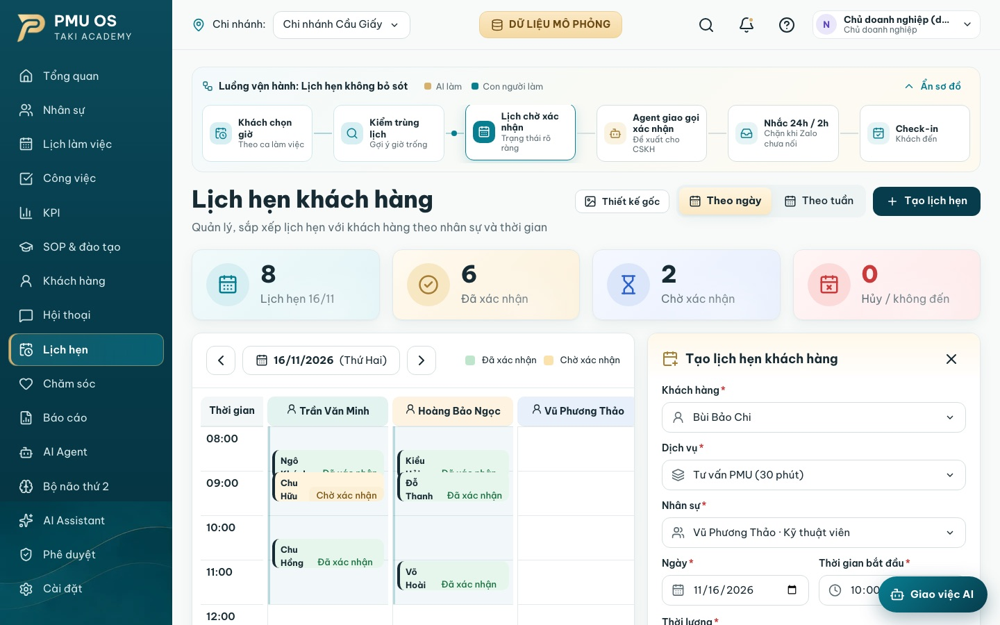 | 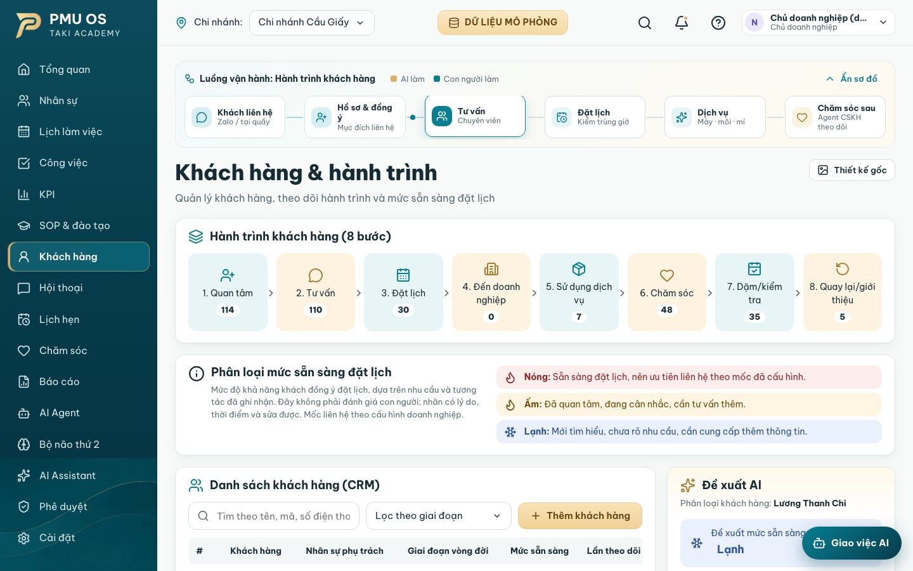 |

| Lịch làm việc | Điện thoại |
| --- | --- |
| 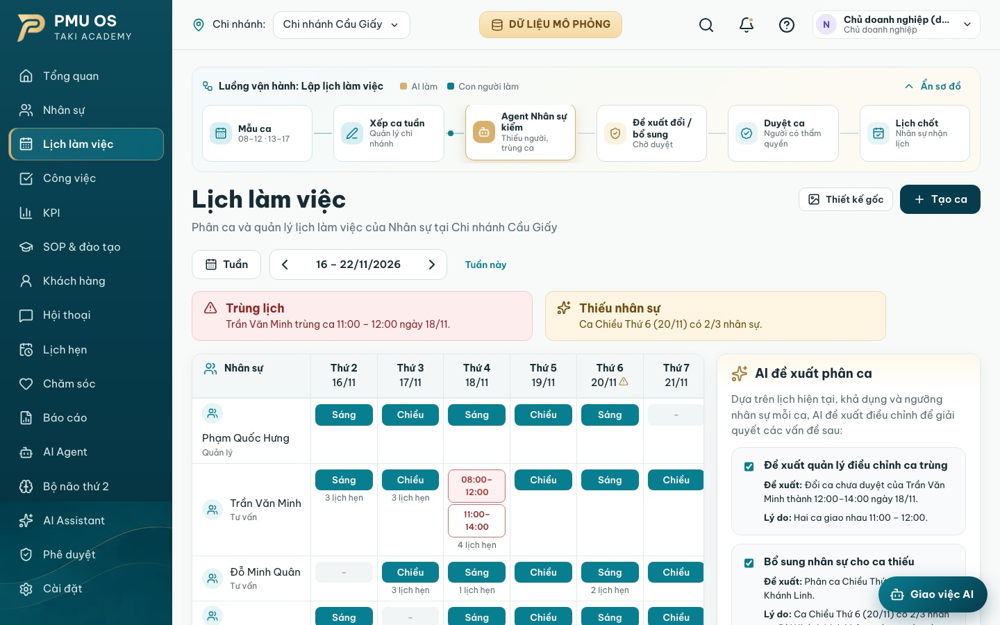 | 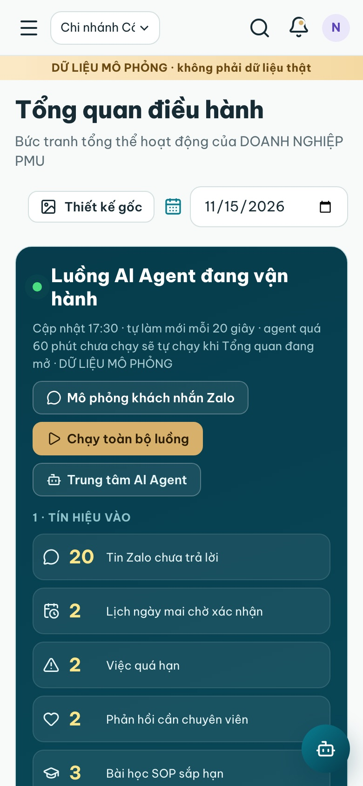 |

### 9. An toàn và kiểm soát

- Phân quyền kiểm tại máy chủ theo module × hành động; tách dữ liệu từng doanh nghiệp, từng chi nhánh.
- AI chỉ thấy dữ liệu trong phạm vi quyền của người dùng; nội dung tin nhắn, tài liệu được coi là dữ liệu, không phải mệnh lệnh.
- Mức tự chủ: L0 chỉ gợi ý · L1 đề xuất chờ duyệt · L2 tự làm việc rủi ro thấp (nhắc việc nội bộ). Gửi khách, đổi ca, xuất bản SOP tối đa L1.
- Chỉ liên hệ khách đã đồng ý, tôn trọng giờ yên tĩnh; rút đồng ý thì dừng các lượt nhắc chưa gửi.
- Mọi thao tác có nhật ký; không có secret nào trong mã nguồn hay gửi xuống trình duyệt.

---

## Hướng dẫn sử dụng nhanh

| Bước | Làm gì | Ảnh |
| --- | --- | --- |
| 1 | Mở https://pmu-os-xi.vercel.app → **Khám phá bản demo**. Mỗi lượt tạo một doanh nghiệp demo riêng, đặt lại được. | 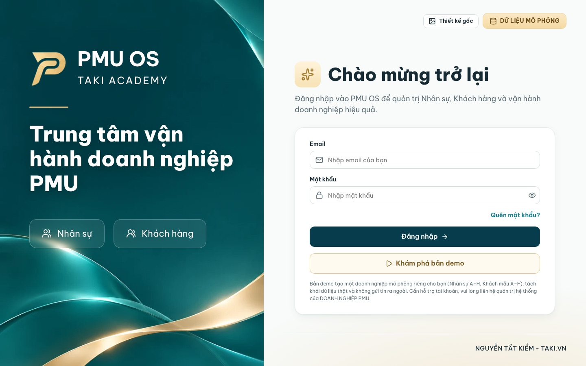 |
| 2 | Ở **Tổng quan**, bấm **Chạy toàn bộ luồng** để 4 agent chạy, hoặc **Mô phỏng khách nhắn Zalo** để xem agent xử lý một tin đến. | [Xem ảnh](docs/images/03-mo-phong-tin-zalo.jpg) |
| 3 | Bấm **Giao việc AI** (góc phải dưới), gõ một câu giao việc. Trợ lý trả về đề xuất kèm đường dẫn. | [Xem ảnh](docs/images/04-chat-giao-viec.jpg) |
| 4 | Vào **Phê duyệt** để duyệt / trả lại / từ chối đề xuất của agent. | [Xem ảnh](docs/images/08-phe-duyet.jpg) |
| 5 | Vào **Bộ não thứ 2**, duyệt các bài học agent vừa rút ra để agent dùng từ lượt sau. | [Xem ảnh](docs/images/06-bo-nao-thu-2.jpg) |
| 6 | Menu tài khoản (góc phải trên) → đổi vai trò sang quản lý chi nhánh, tư vấn, kỹ thuật viên, CSKH, lễ tân để xem quyền khác nhau. | |
| 7 | **AI Agent** → **Dừng khẩn cấp** khi cần dừng toàn bộ agent; các thao tác thủ công vẫn chạy. | [Xem ảnh](docs/images/05-trung-tam-ai-agent.jpg) |

---

## Chạy trên máy

Yêu cầu: Node.js 20 trở lên. Không cần cài Postgres: khi `DATABASE_URL` trống, hệ thống dùng PGlite (Postgres nhúng) lưu ở `./.data/pglite`.

```bash
npm install
npm run dev
```

Mở http://localhost:3730 → **Khám phá bản demo**.

### Biến môi trường

Tạo file `.env.local` (đã có mẫu `.env.example`, không chứa secret):

| Biến | Bắt buộc | Ý nghĩa |
| --- | --- | --- |
| `DATABASE_URL` | Không | Chuỗi kết nối PostgreSQL (ví dụ Neon). Trống = PGlite cục bộ. |
| `OWNER_EMAIL`, `OWNER_PASSWORD` | Không | Tài khoản chủ doanh nghiệp thật. Lần đăng nhập đầu đúng cặp này sẽ tạo doanh nghiệp thật và nạp sẵn DỮ LIỆU MÔ PHỎNG (xóa ở **Cài đặt › Doanh nghiệp › Dữ liệu mô phỏng**, gõ `XOA`). |
| `ANTHROPIC_API_KEY` | Không | Bật Claude cho khung chat giao việc qua API (tính tiền theo token). |
| `AI_BRAIN` | Không | `claude-cli` để dùng Claude CLI trên máy cá nhân; `rules` để ép chế độ quy tắc. |
| `CLAUDE_CLI_PATH` | Không | Đường dẫn Claude CLI nếu không tự tìm thấy. |

---

## Bộ não ngôn ngữ cho trợ lý

Khung chat chọn bộ não theo thứ tự:

| Chế độ | Khi nào | Ghi chú |
| --- | --- | --- |
| **Claude API** | Có `ANTHROPIC_API_KEY` | Model `claude-opus-5-5`, công cụ chạy tại máy chủ theo quyền người chat, bật dự phòng phía máy chủ (`fallbacks: "default"`). |
| **Claude CLI** | `AI_BRAIN=claude-cli`, chạy trên máy cá nhân (không chạy trên Vercel) | Dùng gói Claude đã đăng nhập trên máy, không cần API key. Mỗi bước 4–5 giây, câu nhiều bước 30–40 giây. Chỉ dành cho chính chủ tài khoản Claude dùng trên máy của mình. |
| **Quy tắc** | Không có hai chế độ trên | Hiểu “Giao [họ tên] …”, “Chạy agent …”, “Tra bộ não …”, câu hỏi vận hành có nguồn. |

Giới hạn lượt AI mỗi 24 giờ đặt ở `ai_policy.budget_per_day` (demo 40, doanh nghiệp thật 200). Hết lượt tự chuyển sang chế độ quy tắc.

---

## Đưa lên Vercel

```bash
vercel link
vercel integration add neon      # tạo PostgreSQL Neon, tự gắn DATABASE_URL
vercel env add OWNER_EMAIL production
vercel env add OWNER_PASSWORD production
vercel env add ANTHROPIC_API_KEY production   # tùy chọn
vercel --prod
```

Migration SQL trong `db/migrations` được nhúng vào mã lúc build và tự chạy khi khởi động.

---

## Kiểm thử nghiệm thu

```bash
BASE_URL=http://localhost:3730 npm run test:ac
```

22 kiểm tra tự động: AC01–AC09, AC11, AC12 (phạm vi dữ liệu, giao việc, đặt lịch trùng đồng thời, chống lặp, AI có nguồn, duyệt hai lần, rút đồng ý, Zalo chưa kết nối, báo cáo có nguồn, không lộ secret) và AG01–AG07 cho hệ AI Agent (chống đề xuất trùng, dừng khẩn cấp, chat giao việc, phân quyền agent, Bộ não chỉ dùng mục đã duyệt, 20 hội thoại Zalo, tin đến → agent xử lý). Chi tiết: [docs/NGHIEM-THU.md](docs/NGHIEM-THU.md).

---

## Kiến trúc và thư mục

- **Next.js 16** (App Router) + **React 19** + **TypeScript**. Một route API tổng `src/app/api/[...path]/route.ts` → bộ định tuyến `src/lib/server/router.ts`.
- **PostgreSQL** (Neon) hoặc **PGlite** qua `src/lib/server/db.ts`, SQL thuần, migration tự chạy.

```
src/
  app/(app)/            các màn hình: dashboard, agents, brain, people, shifts, tasks, performance,
                        knowledge, customers, inbox, appointments, care, reports, assistant, approvals, settings
  components/
    AgentPipeline.tsx   luồng AI Agent trên Tổng quan
    AgentChat.tsx       khung chat “Giao việc AI”
    FlowStrip.tsx       sơ đồ hình khối chạy ở mỗi menu
  lib/server/
    agents.ts           4 agent chuyên trách + chống trùng đề xuất
    agent-chat.ts       trợ lý giao việc: Claude API / Claude CLI / quy tắc, công cụ theo quyền
    brain.ts            Bộ não thứ 2: tra cứu, ghi bài học chờ duyệt, đếm ý định khách
    proposals.ts        đề xuất, phê duyệt, thực thi đúng một lần
    generator.ts        sinh DỮ LIỆU MÔ PHỎNG dày (2 chi nhánh, 22 nhân sự, 560 khách)
    scenarios.ts        20 kịch bản hội thoại Zalo + nội dung khởi tạo Bộ não
    routes/*.ts         API theo phân hệ
  lib/shared/perms.ts   ma trận quyền module × hành động
db/migrations/          001 lược đồ gốc · 002 agent · 003 Bộ não thứ 2
scripts/ac-test.mjs     kiểm thử nghiệm thu
docs/                   kiến trúc, nghiệm thu, ảnh hướng dẫn
public/design/          16 ảnh thiết kế gốc (xem trong app tại /thiet-ke)
```

Chi tiết quyết định thiết kế: [docs/KIEN-TRUC.md](docs/KIEN-TRUC.md).

---

## Giới hạn hiện tại

- Kênh Zalo chưa kết nối: tin gửi khách chỉ ở trạng thái bản nháp / chờ duyệt / gửi thủ công và ghi nhận.
- Agent “chạy theo lịch” chỉ chạy khi có người mở màn Tổng quan (Vercel không có tiến trình nền liên tục).
- Chưa có sao lưu / khôi phục tự động và giám sát lỗi (AC13).
- Chưa gửi email (mời thành viên, quên mật khẩu báo rõ là chưa gửi).
- Dữ liệu trong bản demo là mô phỏng; không dùng số liệu trong ảnh làm số liệu kinh doanh thật.

Mã nguồn công khai để tham khảo, chưa gắn giấy phép mã nguồn mở. Muốn dùng lại cho mục đích thương mại, vui lòng liên hệ tác giả.

---

NGUYỄN TẤT KIỂM - TAKI.VN
